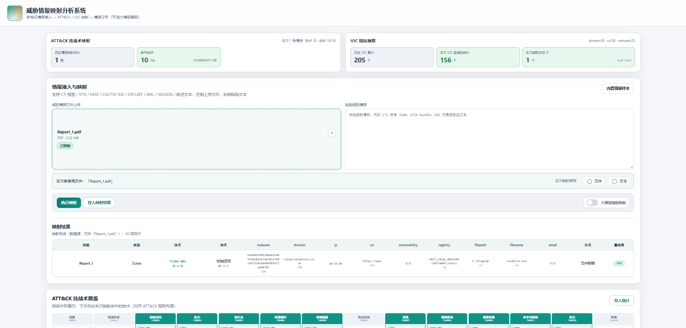
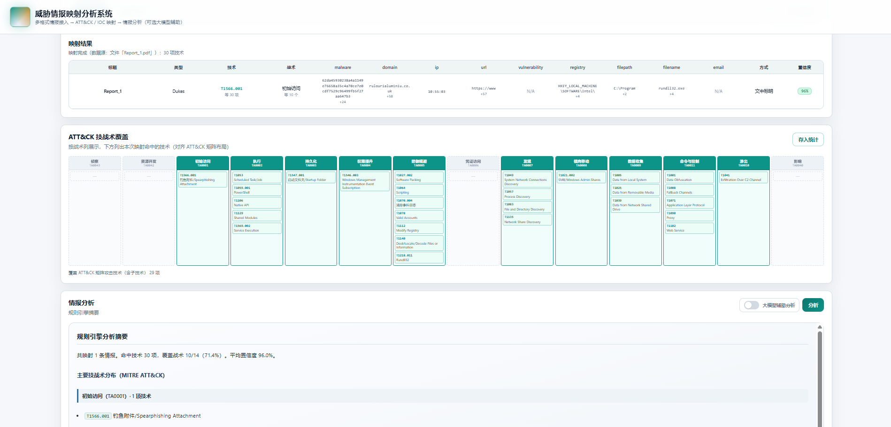

# README

Offline prototype for extracting actionable artifacts from **heterogeneous cyber threat intelligence (CTI) documents**, mapping them to **MITRE ATT&CK** techniques/tactics, and constructing **evidence-faithful attack stages**—without requiring external enrichment APIs or cloud LLMs for the default sealed path.

**System Overview**

Tailored for air-gapped and connectivity-limited environments, our method adheres to three fundamental constraints ensuring auditability and evidence faithfulness:

**C1: Static Knowledge Grounding.** Alignment relies exclusively on a fixed offline ATT&CK snapshot, precluding online retrieval or dynamic fine-tuning to ensure deterministic reproducibility.

**C2: Traceable Provenance.** Every non-null output encodes its derivation path within the cascade (identifiers, rules, heuristics, IOC residual, or fallbacks), thereby prohibiting opaque end-to-end mappings as the sole decision path.

**C3: Evidence-Faithful Reconstruction.** We refrain from imputing unobserved tactics, ensuring reconstructed stages represent a verifiable lower bound on adversary activity supported by the document.

These constraints mandate achieving accuracy through hierarchical evidence fusion rather than external augmentation, distinguishing our approach from both SIEM-style alert correlation and unconstrained LLM-based labeling.





**This repository is intended for local demonstration and paper review. On Windows, reviewers can start the UI with a double-click.**

---

## Features

- **CTI document → ATT&CK alignment** via a five-layer evidence cascade (explicit technique IDs, threat-type rules, lexicon/name matching, IOC-conditioned residual, conservative default), with an auditable layer tag and confidence
- **Multi-format ingestion**: PDF, HTML/MHTML/EML, JSON/STIX/MISP-like, tabular IOC lists, and narrative text; indicator restoration for defanged IOCs before typing
- **Attack staging** via ATT&CK alias resolution and parent/subtechnique collapse (prefer subtechnique), projected onto the Enterprise tactic order **without** inventing missing stages
- **Browser UI**: upload/paste reports, batch mapping, IOC columns, tactic coverage, optional campaign-style analysis view
- **Optional gated residual assist**: local/compatible vector re-ranking and LLM repair for **weak** mappings only; provenance tags are retained. Default offline demo runs with these paths disabled
- **Optional MongoDB**: persist mapped items when you click “store”; without MongoDB the demo runs in memory mode

---

## Requirements

| Software        | Required?       | Notes                                                        |
| --------------- | --------------- | ------------------------------------------------------------ |
| **Node.js 16+** | **Yes**         | Runs the Express API and serves the frontend                 |
| **MongoDB 5+**  | Optional        | Needed only for persistence / cumulative stats; demo works without it |
| **npm**         | Yes (with Node) | Installs backend packages                                    |
| LLM / vector API | No (default)   | Required only if you enable gated residual assist in `.env`  |

Check versions:

```bash
node -v
npm -v
```

Install Node from [https://nodejs.org](https://nodejs.org) (LTS) if needed. Restart the terminal after install.

---

## npm packages (backend)

Declared in `backend/package.json`:

| Package      | Role                                 |
| ------------ | ------------------------------------ |
| `express`    | HTTP API and static file hosting     |
| `mongoose`   | MongoDB access (optional at runtime) |
| `cors`       | Cross-origin support                 |
| `multer`     | File upload for CTI documents        |
| `pdfjs-dist` | PDF text extraction                  |
| `dotenv`     | Environment configuration            |
| `uuid`       | Identifiers                          |

Install (automatic if you use `start-local.bat`):

```bash
cd backend
npm install
```

---

## Quick start (Windows)

1. Clone or unpack this repository.
2. Ensure sealed knowledge exists under `data/` (at least `attck_enterprise.json` or `ATTCK.json`, plus `mapping_knowledge.json` / aliases as shipped).
3. Double-click **`start-local.bat`** in the repository root.
4. Wait until the console shows the server is listening.
5. Open a browser at **http://127.0.0.1:3100/**

The script will:

- create `.env` from `.env.example` if missing
- `cd` into `backend/`
- run `npm install` if `node_modules` is missing
- free port `3100` if an old Node process is still bound
- start `node app.js`

Stop the server with **Ctrl+C** in that console window (or close the window).

**Suggested demo path in the UI**

1. Upload or paste a CTI report (PDF / HTML / MHTML / JSON, etc.).
2. Run mapping / one-click pipeline (leave LLM/vector toggles **off** for the sealed offline setting).
3. Inspect mapped techniques, IOC columns, provenance layer tags, and tactic coverage.
4. (Optional) Enable gated assist only if API keys are configured; (optional) click store only if MongoDB is running.

---

## Quick start (command line)

### Windows (PowerShell)

```powershell
.\start-local.bat
```

Or:

```powershell
cd backend
npm install
$env:PORT="3100"
npm start
```

### Linux / macOS

```bash
cd backend
npm install
export PORT=3100
npm start
```

Then open **http://127.0.0.1:3100/**

---

## MongoDB (optional)

Default URI:

```text
mongodb://127.0.0.1:27017/qy_threat_intel
```

Override with `MONGO_URI` if needed.

- **Without MongoDB**: the API starts in **memory mode**. Mapping and staging still work; “store” / cumulative history will not persist across restarts.
- **With MongoDB**: start the database service, then optionally initialize:

```bash
cd backend
export MONGO_URI=mongodb://127.0.0.1:27017/qy_threat_intel
npm run init-db
```

Health check (includes Mongo / LLM / vector readiness):

```bash
curl -s http://127.0.0.1:3100/api/health
```

Expect `"ok": true`. `"mongo": true` only when the database is connected. `"llmReady"` / `"vectorReady"` are `true` only when the corresponding keys are set.

---

## Repository layout

```text
.
├── start-local.bat          # Windows one-click start
├── .env.example             # Config template (no secrets)
├── README.md                # This file
├── system1.png / system2.png  # Overview figures (paper Fig.1 / results panel)
├── frontend/                # Static UI (index.html, css/, js/)
├── backend/                 # Express API (app.js, src/, scripts/)
│   ├── package.json
│   ├── app.js
│   ├── src/                 # Cascade, ingestion, IOC, optional assist
│   └── scripts/             # init-db, ATT&CK build, gold compare
└── data/
    ├── attck_enterprise.json      # Preferred sealed ATT&CK snapshot
    ├── ATTCK.json                 # Legacy fallback corpus
    ├── mapping_knowledge.json     # Type rules / lexicon / display columns
    └── attck_official_aliases.json
```

---

## Environment variables

| Variable                 | Default                                     | Description                                             |
| ------------------------ | ------------------------------------------- | ------------------------------------------------------- |
| `PORT`                   | `3100`                                      | HTTP listen port                                        |
| `ATTCK_PATH`             | auto-detected under `data/`                 | Path to ATT&CK JSON (`attck_enterprise.json` preferred) |
| `MAPPING_KNOWLEDGE_PATH` | auto-detected under `data/`                 | Optional override for mapping knowledge                 |
| `MONGO_URI`              | `mongodb://127.0.0.1:27017/qy_threat_intel` | MongoDB connection string                               |

Leave LLM/vector keys empty to reproduce the **sealed offline cascade** used in the paper’s main tables.

---

## Main API endpoints

| Method | Path                    | Description                                    |
| ------ | ----------------------- | ---------------------------------------------- |
| GET    | `/api/health`           | Liveness                                       |
| GET    | `/api/attck/tactics`    | Tactic/technique dictionary                    |
| GET    | `/api/mapping/rules`    | Type rules and method labels                   |
| POST   | `/api/mapping/batch`    | Ingest + cascade mapping (compute only)        |
| POST   | `/api/pipeline`         | End-to-end map (+ optional gated assist flags) |
| POST   | `/api/analyze`          | Campaign-style analysis brief                  |
| POST   | `/api/persist`          | Write mapped items/stats to Mongo              |
| GET    | `/api/stats/cumulative` | Cumulative stats (Mongo)                       |
| GET    | `/api/samples`          | List sample items (if seeded)                  |

Mapping **does not write** to Mongo until `/api/persist` (or the UI store action) is used.

---

## Offline gold evaluation (paper protocol)

If you have the paired report/JSON evaluation corpus:

```bash
cd backend
node scripts/compare-report-vs-json.js --all --report-dir <PATH_TO_REPORT> --json-dir <PATH_TO_JSON>
```

This script runs the **sealed cascade** (vector/LLM disabled) and reports text-visible vs corpus-wide IOC/technique recall and related diagnostics.

---

## Troubleshooting

| Symptom                     | Likely cause                      | Fix                                                              |
| --------------------------- | --------------------------------- | ---------------------------------------------------------------- |
| ATT&CK file not found       | Wrong working directory / path    | Set `ATTCK_PATH` to `data/attck_enterprise.json` (absolute path) |
| Page loads, API fails       | Backend not running               | Keep the `start-local.bat` window open; check `/api/health`      |
| `npm install` fails         | No Node/npm or network blocked    | Install Node LTS; retry in `backend/`                            |
| Store fails                 | MongoDB not running               | Start `mongod`, or ignore store and use memory mode              |
| Port in use                 | Old Node process                  | The bat script tries to free `:3100`; or change `PORT`           |
